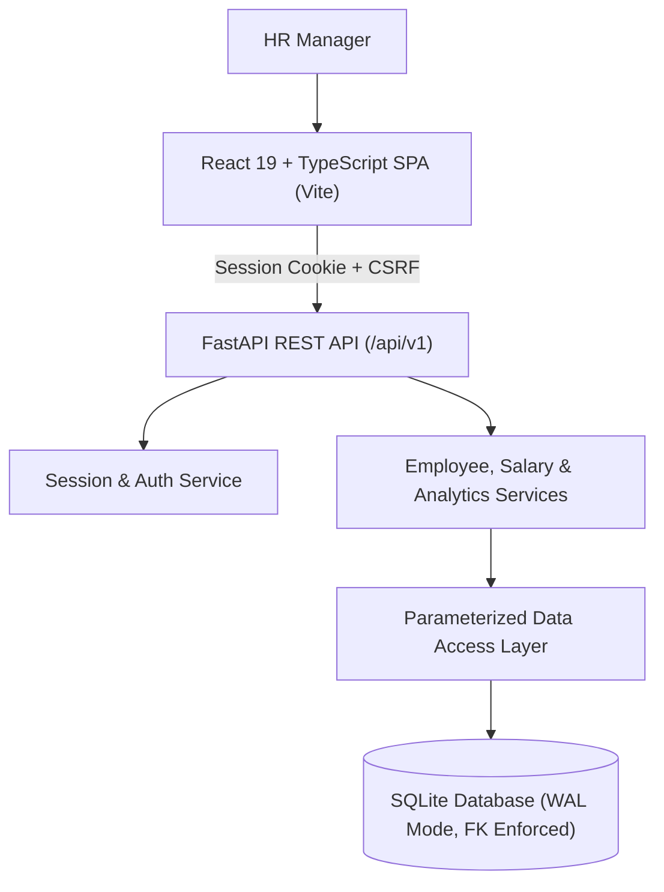

# ACME Salary Management System

A production-grade, internal HR salary management and analytics web application built for **ACME** (10,000 employees). Designed and implemented for the **Incubyte Take-Home Assessment**.

<p align="center">
  <a href="./demo-walkthrough.mp4">
    
  </a>
  <br/>
  <em>🎥 <strong>Interactive Product Walkthrough (with Live Captions)</strong> — Click above to watch or open <a href="./demo-walkthrough.mp4"><code>demo-walkthrough.mp4</code></a>.</em>
</p>

---

## 1. System Overview & Core Capabilities

- **10,000 Seeded Employees:** Deterministic, reproducible generation across realistic global departments, job titles, countries, and USD salary distributions.
- **Transactional Salary Updates:** Salary changes are decoupled from general employee editing. Updating an employee's salary atomically records an immutable audit entry in `salary_history` and updates current compensation within an immediate database transaction (`BEGIN IMMEDIATE`).
- **Initial Salary Preservation:** Creating an employee automatically writes their initial salary entry to history (`previous_salary = NULL`).
- **Programmatic Compensation Analytics:** Fast, deterministic calculation of Average, Median (exact 50th percentile with arithmetic mean of two middle items for even counts), Minimum, Maximum, and Department Breakdowns that dynamically respond to active filters.
- **Enterprise Security:** Argon2 password hashing, server-managed session cookies (`HttpOnly`, `SameSite`), and CSRF token protection on state-changing requests.
- **Sub-Millisecond Performance:** Indexed SQLite queries with Write-Ahead Logging (WAL) delivering **~1.36ms** paginated employee lookups and **~13.36ms** full analytics calculations over 10,000 records.

---

## 2. Architecture & Tech Stack



- **Backend:** Python 3.12+, FastAPI, Pydantic, Argon2-cffi, managed via [`uv`](https://docs.astral.sh/uv/).
- **Frontend:** React + TypeScript, Vite, Lucide Icons, clean custom enterprise HR design tokens.
- **Database:** SQLite with strict foreign key constraints (`PRAGMA foreign_keys = ON`), Write-Ahead Logging (`PRAGMA journal_mode = WAL`), and USD money stored in integer cents.
- **Production Mode:** FastAPI optionally serves the compiled React Single Page Application directly from `frontend/dist`, offering a self-contained single-container or single-server deployment with zero CORS friction.

---

## 3. Quickstart & Local Setup

### Prerequisites
- Python 3.12+ and [`uv`](https://github.com/astral-sh/uv) (`curl -LsSf https://astral.sh/uv/install.sh | sh`)
- Node.js 18+ and `npm`

### Step 1: Install Dependencies
```bash
# Backend dependencies
cd backend
uv sync

# Frontend dependencies
cd ../frontend
npm install
cd ..
```

### Step 2: Bootstrap HR Manager Account
Create your local HR user credentials using the secure CLI helper:
```bash
cd backend
uv run python scripts/create_hr_user.py --email hr@acme.test --password "hr@123456"
cd ..
```

### Step 3: Seed 10,000 Employee Records
Seed the database with 10,000 deterministic employees and initial salary records (executes in <0.2s):
```bash
cd backend
uv run python scripts/seed.py --count 10000
cd ..
```
*Note: Rerunning the seed script is safe and idempotent. To wipe and re-seed from scratch, add the `--reset` flag.*

### Step 4: Run Development Servers
In terminal 1 (Backend API):
```bash
cd backend
uv run uvicorn app.main:app --reload --port 8000
```
*Open [http://localhost:8000/docs](http://localhost:8000/docs) to view the interactive OpenAPI documentation.*

In terminal 2 (Frontend UI):
```bash
cd frontend
npm run dev
```
*Open [http://localhost:5173](http://localhost:5173) in your browser and log in with:*
- **Email:** `hr@acme.test`
- **Password:** `hr@123456`


---

## 4. Running Automated Tests & Performance Benchmarks

### Backend Test Suite (Unit, Integration, Rollback & Benchmarks)
```bash
cd backend
uv run pytest -v
```
All 14 tests execute against in-memory SQLite fixtures in ~1 second, covering:
- Exact integer-cent money conversion and precision validation
- Atomic initial salary history generation upon employee creation
- Concurrent transaction rollback when salary update constraints fail
- Session cookie validation, CSRF verification, and logout invalidation
- Programmatic median and department breakdown calculations
- SQLite `EXPLAIN QUERY PLAN` verification showing index utilization

### Performance Measurements (10,000 Seeded Records)
Run the automated benchmark suite:
```bash
cd backend
uv run pytest tests/integration/test_performance.py -s -v
```
**Actual Benchmark Results on 10,000 Employee Records:**
- **Paginated & Filtered Employee Query:** `1.36 ms`
- **Full Statistical Analytics Calculation (10k records):** `13.36 ms`
- **10,000 Employee Seed Insertion Time:** `0.16 s`

### Frontend Production Build & Typecheck
```bash
cd frontend
npm run build
```
Compiles and bundles the TypeScript React application cleanly into `frontend/dist/`.

---

## 5. Production Deployment (Docker & Persistent Storage)

Because SQLite stores state in a local file, persistent storage is required so data survives restarts.

### Option A: Turnkey Docker Compose (Persistent Volume)
The Docker container automatically bootstraps the HR account (`hr@acme.test` / `hr@123456`) and seeds the 10,000 employees out of the box:
```bash
# Build and start container (pre-seeded automatically)
docker compose up -d --build
```
Access the application immediately at [http://localhost:8000](http://localhost:8000).

### Option B: Cloud Hosting (Render, Fly.io, Railway)
1. Connect your repository and deploy with Docker runtime.
2. Mount a persistent disk volume to `/data` (optional; if unmounted, in-container storage persists per instance).
3. The container's entrypoint automatically seeds 10,000 employees and binds to `${PORT:-8000}`.

---

## 6. Video Demo Walkthrough

A high-definition video walkthrough featuring automated live captions and demonstrating all end-to-end flows is included directly in this repository:

<p align="center">
  <video src="./demo-walkthrough.mp4" controls width="100%" poster="./screenshot-dashboard.png"></video>
</p>

🎥 **Direct Video File:** [**`demo-walkthrough.mp4`**](./demo-walkthrough.mp4) (H.264 / 1280x720 / ~896 KB)


### Walkthrough Narrative & Key Moments:
1. **Security & Login (0:00 - 0:04):** Sign in with `hr@acme.test` / `hr@123456`. Argon2id password verification, `HttpOnly` session cookie issuance, and CSRF protection.

2. **Executive Overview (0:04 - 0:08):** High-level headcount and compensation distribution across 10,000 active employees.
3. **10,000-Record Directory (0:08 - 0:12):** Sub-millisecond indexed queries (~1.36ms) across global departments and jurisdictions.
4. **Multi-Attribute Filtering (0:12 - 0:16):** Instant filtering across department, country, and compensation bands.
5. **Transactional Salary Update (0:16 - 0:20):** Atomic salary adjustments using `BEGIN IMMEDIATE` transactions with automated rollback protection, decoupled from profile edits.
6. **Immutable Audit Trail (0:20 - 0:25):** Historical timeline inspection showing previous salary, new salary, exact dollar delta, and percentage change.
7. **Programmatic Analytics (0:25 - 0:29):** Dynamic Average, exact Median (50th percentile), Min/Max, and department breakdown calculated without LLM math.
8. **Session Invalidation (0:29 - 0:31):** Secure logout and protected route guarding.

---


## 7. Documentation Index

Detailed planning artifacts are preserved under [`docs/`](./docs):
- [`docs/01-requirements.md`](./docs/01-requirements.md) — Product requirements and boundary definition
- [`docs/02-discussion-and-decision-log.md`](./docs/02-discussion-and-decision-log.md) — Architectural decisions & rationale
- [`docs/03-system-architecture.md`](./docs/03-system-architecture.md) — End-to-end component flows
- [`docs/04-database-design.md`](./docs/04-database-design.md) — Schema, indexes, and transactions
- [`docs/05-api-specification.md`](./docs/05-api-specification.md) — REST API contracts & error shapes
- [`docs/06-code-structure-and-standards.md`](./docs/06-code-structure-and-standards.md) — Coding conventions & folder layout
- [`docs/07-implementation-plan.md`](./docs/07-implementation-plan.md) — Execution roadmap (M0 - M9)
- [`docs/08-testing-strategy.md`](./docs/08-testing-strategy.md) — Test plan and validation strategy
- [`docs/09-tradeoffs-and-performance.md`](./docs/09-tradeoffs-and-performance.md) — Engineering trade-offs
- [`docs/10-ai-agent-instructions.md`](./docs/10-ai-agent-instructions.md) — AI agent implementation protocol
- [`docs/11-security-and-data-integrity.md`](./docs/11-security-and-data-integrity.md) — Security safeguards
- [`docs/12-deployment-and-submission.md`](./docs/12-deployment-and-submission.md) — Deployment & checklist
- [`docs/13-ui-ux-design-guidelines.md`](./docs/13-ui-ux-design-guidelines.md) — HR portal UI/UX tokens
- [`docs/14-visual-walkthrough.md`](./docs/14-visual-walkthrough.md) — Product & visual workflow walkthrough
- [`docs/ai-prompts/README.md`](./docs/ai-prompts/README.md) — Milestone AI prompt log
