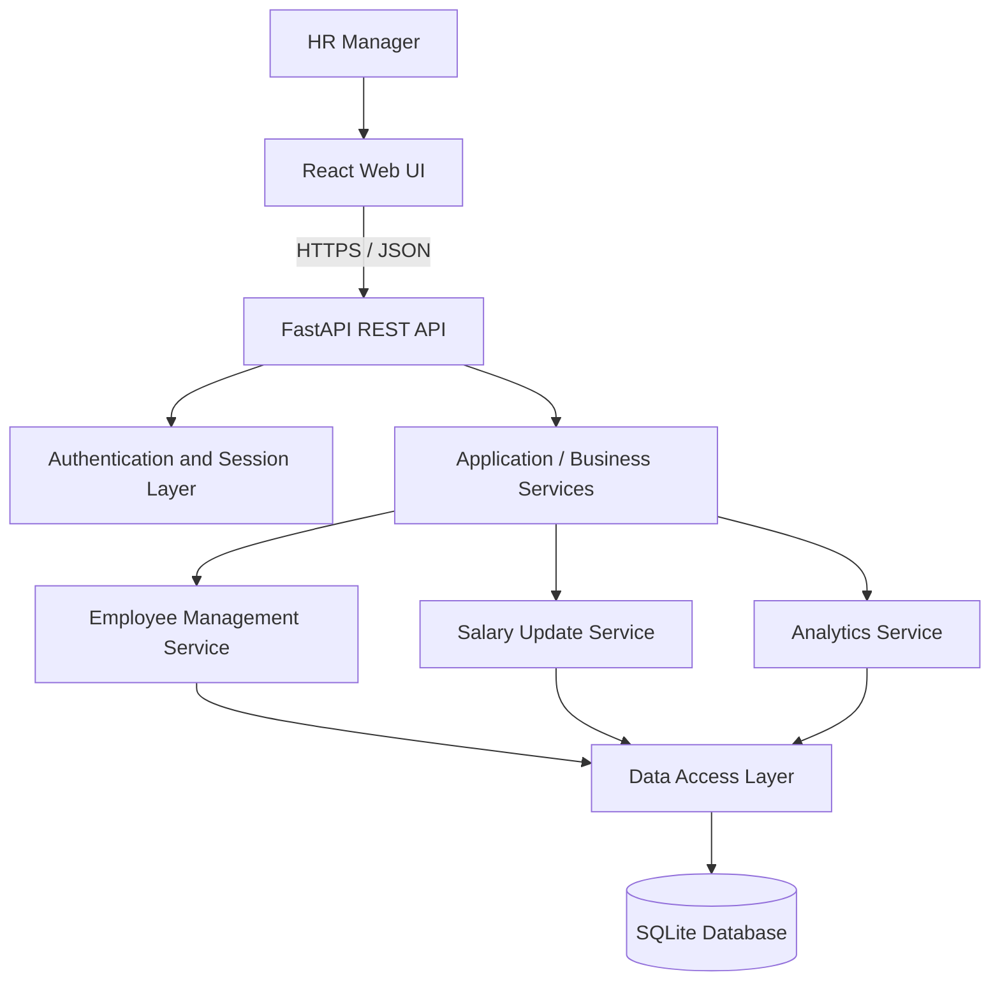

# ACME Salary Management System
## System Architecture and Design

**Document ID:** 03  
**Status:** Draft for review  
**Related documents:** `01-requirements.md`, `02-discussion-and-decision-log.md`

## 1. Purpose

Describe the proposed end-to-end architecture for ACME's internal salary management application. The design prioritizes clarity, maintainability, data consistency, and a scope appropriate for the Incubyte assessment.

## 2. Architecture Principles

- Use a straightforward client-server architecture.
- Keep UI concerns separate from business rules and persistence.
- Keep salary updates in a dedicated backend workflow.
- Keep salary calculations deterministic and testable; do not add an in-product LLM.
- Prefer the simplest architecture that satisfies the assessment rather than adding microservices or unnecessary infrastructure.
- Validate inputs on the server, even when the frontend also validates them.

## 3. High-Level Architecture



### Component responsibilities

| Component | Responsibility |
|---|---|
| React Web UI | Employee directory, search and filters, employee forms, salary update form, analytics views, loading and error states. |
| FastAPI REST API | HTTP endpoints, request parsing, response schemas, status codes, and API-level validation. |
| Authentication and Session Layer | Verify credentials, create and validate server-managed sessions, protect restricted endpoints, and support logout. |
| Application / Business Services | Implement employee-management rules, salary-change behavior, and analytics calculations. |
| Employee Management Service | Create employees, retrieve details, search, filter, paginate, and update non-salary employee fields. |
| Salary Update Service | Retrieve the current salary, validate a requested change, update current salary, and append history in one transaction. |
| Analytics Service | Calculate average, median, minimum, maximum, and department-wise salary breakdown using programmatic logic. |
| Data Access Layer | Encapsulate database queries and persistence operations so endpoint handlers do not contain duplicated SQL. |
| SQLite Database | Persist HR accounts or authentication data, employee records, salary history, and sessions if server-managed sessions are persisted in the database. |

## 4. Proposed Runtime Request Flows

### 4.1 Login

1. The HR Manager submits an email address and password through the login form.
2. The backend looks up the account and verifies the password against a stored password hash.
3. On success, the backend creates a session and sets a cookie with appropriate security attributes.
4. Protected API endpoints validate the session before returning employee or salary information.
5. Logout invalidates the session server-side and clears the browser cookie.

Passwords must never be stored in plaintext. Cookie settings, CSRF protections, session expiry, HTTPS, and initial HR account provisioning must be specified in the security and deployment design.

### 4.2 Create an employee

1. The frontend submits employee details, including the initial salary in USD.
2. The backend validates required fields, email format, salary rules, and uniqueness constraints.
3. In one database transaction, the backend creates the employee with a generated employee ID and inserts the initial salary-history record.
4. If either insert fails, the transaction rolls back.
5. The API returns the created employee or a clear validation/conflict error.

### 4.3 Update employee details

1. The frontend submits editable non-salary fields.
2. The backend validates the request and checks the employee exists.
3. The backend updates allowed fields such as name, email, department, job title, and country.
4. Salary must not be changed through this endpoint; salary changes use the dedicated salary-update workflow.
5. The API returns the updated employee or a meaningful error response.

### 4.4 Update salary

1. The frontend submits the new salary and effective date.
2. The backend authenticates and authorizes the request, validates the input, and starts a database transaction.
3. The backend retrieves the employee's current salary.
4. The backend updates the employee's current salary and inserts a new salary-history record containing the previous salary, new salary, effective date, and record timestamp.
5. The transaction commits only if both writes succeed; otherwise it rolls back.
6. The API returns the updated salary details or a clear error.

The implementation must consider concurrent updates to the same employee so that one update cannot silently produce incorrect history. The exact concurrency strategy will be documented in the detailed database/API design.

### 4.5 List and search employees

1. The UI submits pagination, sort, search, and filter parameters.
2. The API validates allowed parameters and applies filtering on the server.
3. The data-access layer queries SQLite and returns only the requested page plus a total count.
4. The UI displays results and pagination controls.

Filtering should be performed in the database where practical rather than loading all 10,000 records into the browser.

### 4.6 Analytics

1. The UI submits the selected filters.
2. The backend applies the same filter definitions used by the employee directory.
3. The analytics service runs deterministic database queries and/or Python calculations.
4. The API returns average, median, minimum, maximum, and department-wise breakdowns.
5. The UI renders the metrics and handles empty or filtered result sets clearly.

All salaries are USD in the initial version. Analytics must not combine different currencies or apply exchange-rate conversion.

## 5. Proposed Repository Structure

The exact modules may be adjusted during implementation, but the repository should keep the backend, frontend, documentation, and seed process distinct.

```text
acme-salary-management/
├── backend/
│   ├── app/
│   │   ├── api/
│   │   ├── core/
│   │   ├── models/
│   │   ├── schemas/
│   │   ├── services/
│   │   ├── repositories/
│   │   └── main.py
│   ├── tests/
│   │   ├── unit/
│   │   └── integration/
│   ├── scripts/
│   │   └── seed.py
│   ├── pyproject.toml
│   └── README.md
├── frontend/
│   ├── src/
│   │   ├── components/
│   │   ├── features/
│   │   ├── pages/
│   │   ├── services/
│   │   ├── hooks/
│   │   └── types/
│   ├── tests/
│   └── package.json
├── docs/
│   ├── 01-requirements.md
│   ├── 02-discussion-and-decision-log.md
│   ├── 03-system-architecture.md
│   └── diagrams/
├── .gitignore
└── README.md
```

This is a proposed structure, not a requirement from Incubyte. Keep it proportional to the actual implementation; do not create empty abstraction layers just to match the diagram.

## 6. Database and Transaction Boundaries

SQLite is the selected database to minimize setup and avoid requiring Docker for local development.

The initial logical data model contains:
- **Employees:** employee identity, contact and organizational details, current salary in USD, and timestamps.
- **Salary history:** employee reference, previous salary where applicable, new salary, effective date, and record timestamp.
- **Authentication/session data:** only the tables required by the selected login and session implementation.

Employee creation and its initial history record must be atomic. Salary updates and their history records must also be atomic. Database constraints remain the final guard against duplicate employee IDs/emails and invalid data.

Detailed column definitions, foreign keys, constraints, and indexes belong in `04-database-design.md`.

## 7. Security Boundaries

- Require authentication for employee and salary APIs.
- Restrict access to the HR application rather than exposing salary data publicly.
- Hash passwords using an established password-hashing library and suitable parameters.
- Use secure cookie settings and CSRF protection appropriate to the session implementation.
- Validate and authorize operations on the backend.
- Keep secrets and production credentials out of source control.
- Use HTTPS for a deployed application.
- Avoid committing a populated database containing sensitive information.

The initial version has a simple HR login, not enterprise SSO or a complex role hierarchy.

## 8. Performance Approach

For 10,000 employees, start with straightforward indexed SQL queries, server-side filtering, and pagination. Add indexes based on real query patterns rather than indexing every column. Calculate median and other statistics using deterministic backend logic and test the results against known datasets.

Do not introduce caching, background jobs, distributed services, or other performance infrastructure without measured need.

## 9. Deployment Approach

- Docker is not required for the chosen local development workflow.
- Use SQLite with a clearly configured persistent database-file location.
- Provide reproducible setup and run instructions.
- The assessment explicitly requires deployed software and a video demo, so local execution alone is not the final delivery.
- The deployment target must support the Python API, frontend delivery, HTTPS, secrets configuration, and persistent storage for the SQLite database. Confirm these capabilities before choosing a host.
- Verify the deployed application end to end before recording the demo.

## 10. Design Decisions Still Requiring Detailed Specification

The following details are intentionally deferred to their dedicated documents:
- Exact schemas, constraints, salary precision, and effective-date rules.
- API paths, request/response contracts, error codes, and pagination limits.
- Session lifetime, logout, CSRF, and initial account provisioning.
- Exact frontend library, colors, typography, spacing, responsive behavior, and accessibility rules.
- Final index definitions based on actual queries.
- Hosting provider and persistent-storage configuration.

No deferred item should be guessed silently by the coding agent if it changes scope, security, or data integrity. The agent should flag material ambiguities for review.
