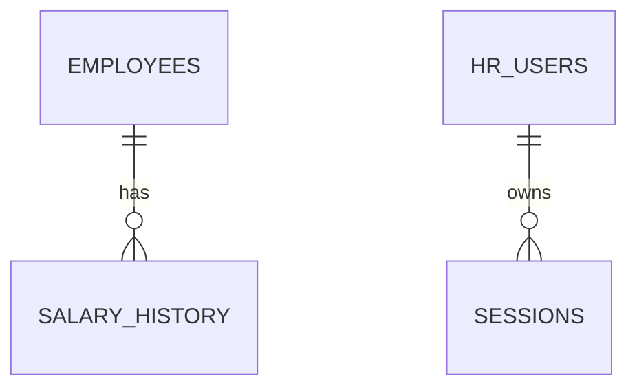

# ACME Salary Management System
## Database Design

**Document ID:** 04  
**Status:** Proposed design for implementation  
**Database:** SQLite

## 1. Design Goals

- Keep the schema understandable and relational.
- Preserve salary history without overwriting past events.
- Enforce data integrity in the database as well as in application code.
- Support 10,000 seeded employees, filtering, pagination, and deterministic analytics.
- Avoid requiring Docker or a separate database server.

## 2. Tables

### 2.1 `employees`

| Column | Proposed type | Constraints / purpose |
|---|---|---|
| `id` | INTEGER | Primary key, generated internally |
| `employee_code` | TEXT | Required, unique, human-readable ID such as `EMP-1001` |
| `full_name` | TEXT | Required, trimmed, non-empty |
| `email` | TEXT | Required, unique; normalize consistently before storage |
| `department` | TEXT | Required |
| `job_title` | TEXT | Required |
| `country` | TEXT | Required |
| `current_salary_cents` | INTEGER | Required, non-negative; USD amount stored in cents |
| `created_at` | TEXT | Required UTC timestamp |
| `updated_at` | TEXT | Required UTC timestamp |

**Money representation:** Store USD in integer cents (for example, `$123.45` as `12345`) to avoid binary floating-point rounding errors. The API may accept decimal USD amounts and convert them to cents after strict validation. The UI formats the value as USD.

### 2.2 `salary_history`

| Column | Proposed type | Constraints / purpose |
|---|---|---|
| `id` | INTEGER | Primary key |
| `employee_id` | INTEGER | Required foreign key to `employees.id` |
| `previous_salary_cents` | INTEGER | Nullable for the initial salary record; otherwise non-negative |
| `new_salary_cents` | INTEGER | Required, non-negative |
| `effective_date` | TEXT | Required ISO date (`YYYY-MM-DD`) |
| `recorded_at` | TEXT | Required UTC timestamp when the change was recorded |

The initial salary record has `previous_salary_cents = NULL` and `new_salary_cents` equal to the employee's initial salary. Each later salary update appends a new record with both previous and new amounts. Existing history rows are not edited as part of ordinary salary updates.

### 2.3 `hr_users`

| Column | Proposed type | Constraints / purpose |
|---|---|---|
| `id` | INTEGER | Primary key |
| `email` | TEXT | Required, unique |
| `password_hash` | TEXT | Required; never store plaintext passwords |
| `is_active` | INTEGER | Required boolean-like value |
| `created_at` | TEXT | Required UTC timestamp |

This supports the agreed single HR login. Account provisioning must be implemented through a documented bootstrap command or environment-driven setup; do not commit a real password or preconfigured production credential.

### 2.4 `sessions`

| Column | Proposed type | Constraints / purpose |
|---|---|---|
| `id` | TEXT | Primary key; high-entropy opaque session identifier or a safe hash of it |
| `hr_user_id` | INTEGER | Required foreign key to `hr_users.id` |
| `created_at` | TEXT | Required UTC timestamp |
| `expires_at` | TEXT | Required UTC timestamp |
| `csrf_token_hash` | TEXT | Optional, depending on selected CSRF implementation |

Store only what the chosen server-managed session design requires. Session IDs must be unpredictable; invalidate sessions on logout and expiry. Avoid storing a raw session token if a hashed-token lookup design is practical.

## 3. Relationships

- One employee can have many salary-history records.
- Every salary-history record belongs to one employee.
- One HR account can have multiple active sessions.
- Enable SQLite foreign-key enforcement for every connection.

## 4. Constraints and Validation

- `employee_code` must be unique and generated by the backend.
- `email` must be unique after consistent normalization (for example, trim and lowercase).
- Names, department, job title, and country must not be empty.
- Salary must be non-negative and conform to two-decimal-place USD precision.
- `salary_history.employee_id` must reference an existing employee.
- `new_salary_cents` must be non-negative.
- `effective_date` must be a valid ISO date.
- Do not add a rule that silently rejects past effective dates until the product's date policy is explicitly decided.
- API validation should return clear errors; database constraints remain the final integrity guard.

## 5. Transaction Rules

### Employee creation
Within one transaction:
1. Generate a unique employee code.
2. Insert the employee.
3. Insert the initial salary-history record with a null previous salary.
4. Commit only when both inserts succeed; otherwise roll back.

### Salary update
Within one transaction:
1. Load the employee's current salary.
2. Validate the requested amount and effective date.
3. Update the current salary and `updated_at`.
4. Insert a history row containing the previous amount and new amount.
5. Commit only when both writes succeed; otherwise roll back.

To avoid lost updates, perform the read and writes in a transaction and use an appropriate SQLite write-locking strategy (such as beginning an immediate transaction) or an explicit expected-current-salary/version check. Return a conflict response if the update is based on stale state.

## 6. Index Strategy

Start with indexes justified by known API query patterns:

- Unique index on `employees.employee_code`.
- Unique index on normalized `employees.email`.
- Indexes for frequently used filters: `department`, `country`, and `job_title`.
- Consider a composite index based on observed combined-filter patterns only after reviewing the actual SQL.
- Consider `current_salary_cents` for salary-range filtering if query plans show benefit.
- Index `salary_history(employee_id, effective_date)` for employee history lookup and chronological display.
- Index session expiry if expired-session cleanup queries require it.

Indexes consume storage and slow writes slightly. Confirm the final list with query plans and tests rather than indexing every column by default.

## 7. Seed Data

- Generate exactly 10,000 deterministic employee records across a plausible mix of departments, job titles, countries, and USD salaries.
- Use a fixed random seed or deterministic generation rules.
- Generate stable employee codes and unique emails.
- Create one initial salary-history record per employee.
- Make repeated runs safe: either detect an already-seeded dataset and exit clearly, or use deterministic upsert logic. Do not silently create duplicates.
- Provide a documented reset option only for development/test environments, with a clear warning before destructive reset.

## 8. Migration and Persistence

- Keep schema creation/migrations reproducible.
- Store the SQLite database at a configurable path outside source-controlled files.
- Ensure the chosen deployment platform provides persistent disk storage; otherwise salary changes may disappear on redeploy.
- Do not commit populated databases, session data, or real credentials.

## 9. Open Implementation Details

The implementation must settle and document: migration approach, exact timestamp format, session token strategy, salary-update concurrency handling, and the chosen seed rerun behavior. These choices must remain consistent with the API specification and tests.
