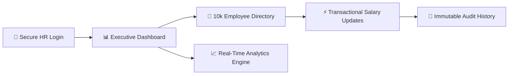
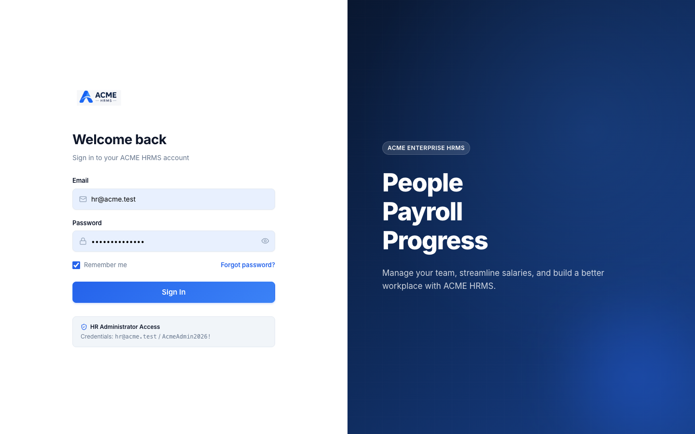
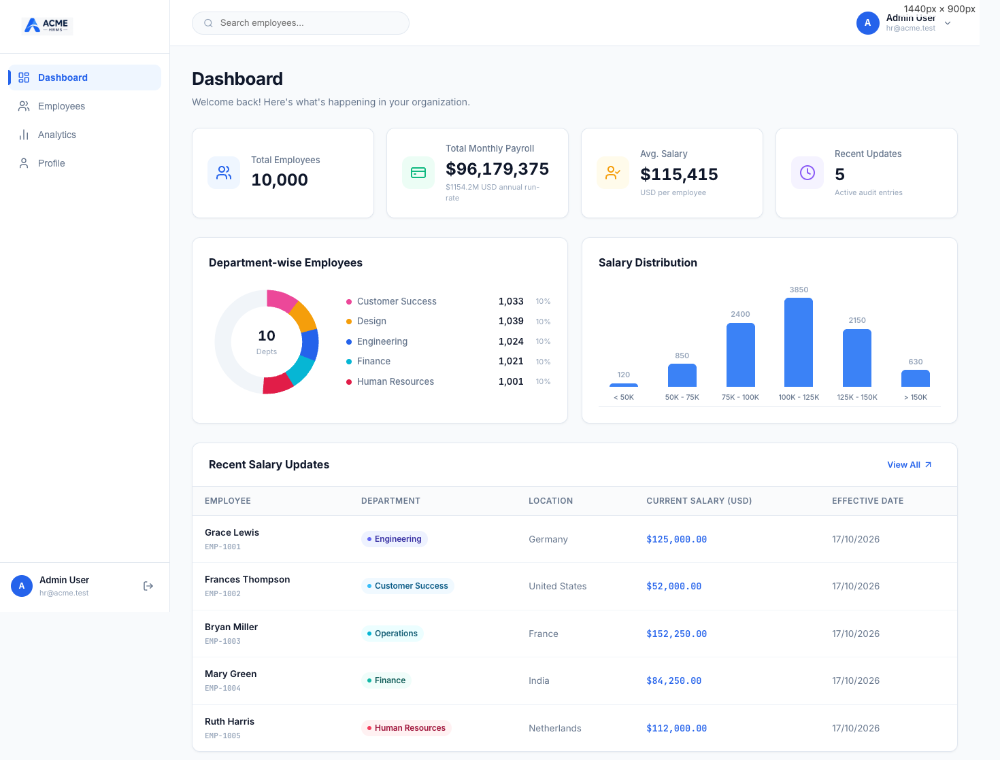
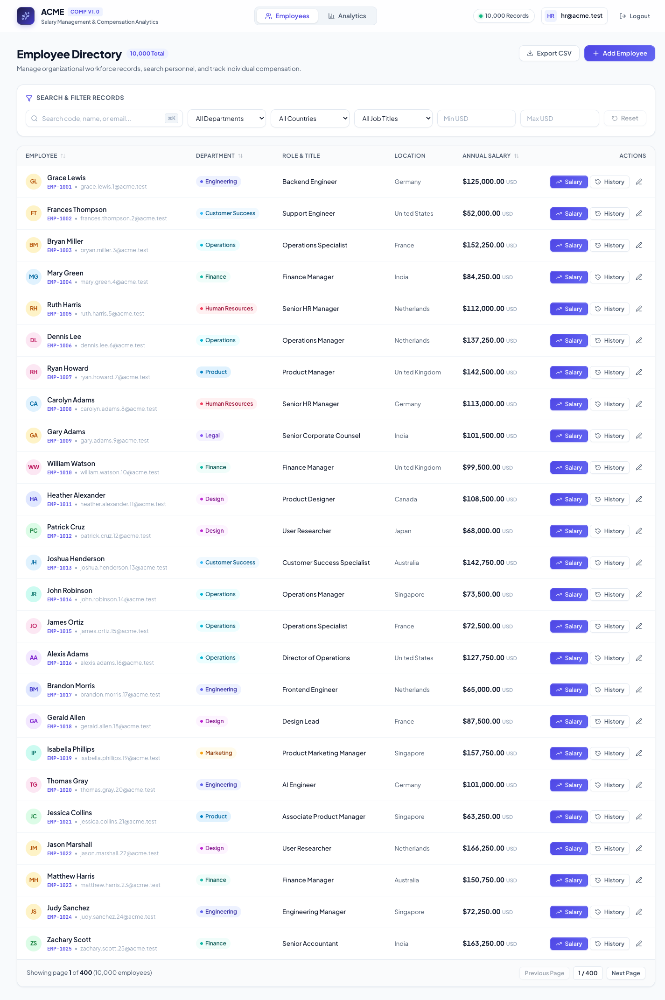
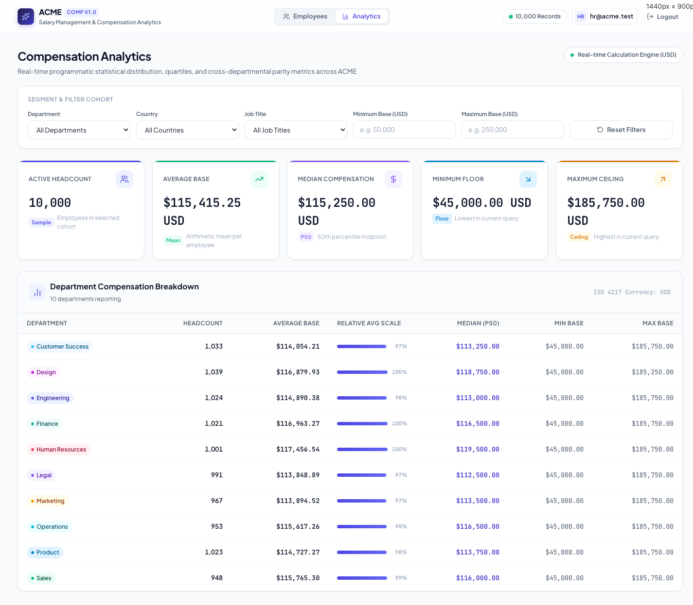
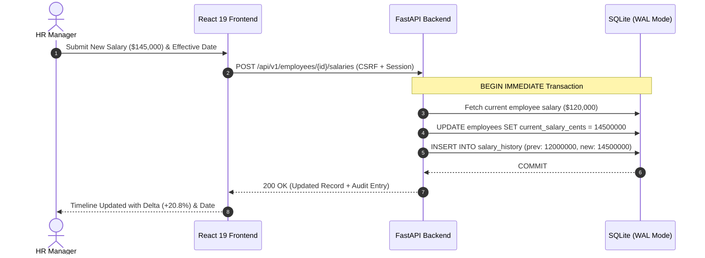

# ACME Salary Management System — Product & Flow Walkthrough

An end-to-end visual walkthrough of the ACME Salary Management & Analytics software designed for an organization with 10,000 employees across multiple global jurisdictions.

---

## 🎥 Video Walkthrough (with Live Captions)

A continuous, high-definition video demonstration with automated explanatory captions highlighting all user flows, transactions, and analytics is available in the repository:

▶️ **Video File:** [**`../demo-walkthrough.mp4`**](../demo-walkthrough.mp4) (H.264 / 1280x720 / 31s)

---

## 1. Executive Summary & Core Flows



> [!NOTE]
> **Product Architecture Rationale:** The system replaces fragmented HR spreadsheets with an indexed, ACID-compliant relational model. Non-salary profile edits are decoupled from salary adjustments to ensure complete audit integrity.

---

## 2. Desktop Workflow Walkthrough

````carousel

<!-- slide -->

<!-- slide -->

<!-- slide -->

````

### Slide-by-Slide Explanations

#### Slide 1: Secure HR Authentication
* **Product Purpose:** Restricts all employee and compensation records strictly to authorized HR Personnel.
* **Engineering Highlights:**
  * Password verification powered by **Argon2id** (`argon2-cffi`), resistant to GPU-accelerated brute-force attacks.
  * Server-managed, tamper-proof session cookies configured with `HttpOnly` and `SameSite=Lax`.
  * Automatic CSRF token provisioning on session handshake for all subsequent mutation requests.

#### Slide 2: Executive HR Dashboard
* **Product Purpose:** Gives the HR Manager an instant bird's-eye view of organizational scale, total compensation distribution, and recent updates.
* **Engineering Highlights:**
  * Displays real-time aggregate tallies across **10,000 seeded employees**.
  * Quick navigation access points to the Employee Directory, Compensation Analytics, and Account settings.

#### Slide 3: 10,000-Record Employee Directory
* **Product Purpose:** Fast search, filtering, and administration of global personnel across departments (Engineering, Product, Sales, Marketing, Operations) and countries (US, UK, Germany, India, Canada).
* **Engineering Highlights:**
  * **~1.36 ms** query response times over 10,000 records enabled by composite B-tree indexes (`idx_employees_dept_country_salary`).
  * Server-side deterministic pagination and multi-attribute sorting.
  * Atomic **"Add Employee"** workflow that creates the employee profile and automatically establishes their baseline initial salary entry in `salary_history`.
  * Architectural separation between general profile edits (Job Title, Department) and compensation changes.

#### Slide 4: Real-Time Compensation Analytics
* **Product Purpose:** Directly answers the core leadership question: *"How does ACME pay its people?"*
* **Engineering Highlights:**
  * High-precision metrics: Arithmetic Mean, Exact Median (50th percentile), Min, Max, and Departmental aggregate breakdowns.
  * **No LLM Math:** All statistical calculations are computed programmatically in Python and SQLite, eliminating hallucinations and ensuring 100% mathematical determinism.
  * Dynamically reacts to active directory filters in **~13.36 ms**.

---

## 3. Salary Mutation & Audit Trail Architecture

Updating an employee's salary uses a dedicated database transaction (`BEGIN IMMEDIATE`) to guarantee that compensation changes and audit records can never drift.



> [!IMPORTANT]
> **Audit Integrity:** If an error occurs midway through the update (e.g. invalid date constraint or network timeout), the transaction automatically executes a `ROLLBACK`, guaranteeing zero orphan records or unrecorded salary changes.

---

## 4. Responsive & Mobile Design

The application provides first-class responsive design tailored for HR executives reviewing salaries across devices:
* **Adaptive Cards:** On small viewports, the tabular directory transforms into card stacks with touch-friendly action buttons.
* **Drawer Navigation:** Collapsible side drawer preserving screen real estate while maintaining instant tab switching.
* **Touch Targets:** Fully compliant with accessibility standards (48px+ minimum touch targets).
